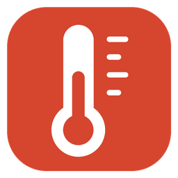

# CookPerfect

A Home Assistant custom integration that reads the probe temperatures of the
CookPerfect Comfort Single wireless meat thermometer over Bluetooth.

**Unofficial, not affiliated with CookPerfect.** It relies on how the receiver
behaves over Bluetooth and may break when the firmware changes. Built and tested
with the Comfort Single only.

## Sensors

- **Core temperature**: the lowest of the four needle readings.
- **Ambient temperature**: the probe's ambient sensor.
- **Needle 1-4** (diagnostic): the four sensors along the needle.

Readings arrive every few seconds. The sensors are unavailable while the receiver
is off, which is the case when the probe cable is unplugged.

## Requirements

- Home Assistant **2026.10.0 or newer**.
- A Bluetooth adapter or Bluetooth proxy within range of the receiver.

## Installation

1. In HACS, open the menu and select **Custom repositories**.
2. Add `https://github.com/mikkelke/ha-cookperfect` with category **Integration**.
3. Find **CookPerfect** and download it.
4. Restart Home Assistant.

## Setup

Plug in the probe cable so the receiver switches on. Home Assistant discovers it;
confirm it under **Settings → Devices & services**. You can also use
**Add integration → CookPerfect**.

## One connection at a time

The receiver accepts a single Bluetooth connection. While Home Assistant is
connected, the CookPerfect phone app cannot connect. To use the app, disable the
integration entry under **Settings → Devices & services**.
